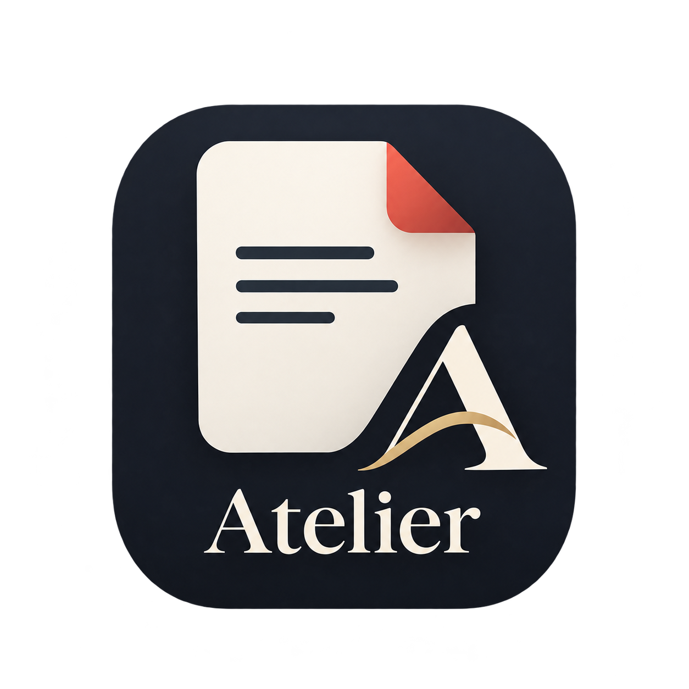

# Atelier



A native PDF viewer and editor, written from the ground up in Rust. No webview:
the PDF engine (parsing, decompression, fonts, rendering, saving) is our own code,
and the app draws pages straight to the GPU.

Release packaging supports Windows x64, macOS on Apple Silicon, and Linux x64/ARM64
(GNU glibc 2.35+). Linux packages include a per-user installer and managed updates. The current development
host is Windows; macOS runtime validation and Keychain work are deferred until a Mac or native CI is available.
See the [single roadmap and current status](docs/roadmap.md) for all planned work.

### Status
The core viewer and editor are in place: pages render with paths, strokes,
clipping, colour, images, text, shadings and patterns. The app also supports
multiple tabs, search, forms, page organization, markup, printing and OCR.
Transparency groups, blend modes and soft masks have working support; PDF
fidelity still needs broader coverage and validation against real-world files.

The viewer opens a file (from the Open button, Ctrl+O, by dropping it on the
window, or on the command line), scrolls through all pages, zooms, selects and
copies text, and searches. Pages are drawn by our renderer in 1024-pixel tiles
on background threads; the window only puts finished tiles on screen, so
moving or resizing it never touches the document.

Fonts a file does not embed are drawn with the system's metric-compatible
fonts: Arial, Times New Roman and Courier New on Windows and macOS, and
Liberation (or DejaVu) on Linux. Chinese, Japanese and Korean text uses the
system's CJK fonts for its script (Yu Gothic, Microsoft YaHei, Malgun Gothic
and the like on Windows; Noto CJK, IPA or WenQuanYi on Linux). Set
`ATELIER_FONT_DIR` to add a folder to search.

Adobe's predefined CJK CMaps are built in, compiled from Adobe's
cmap-resources (BSD-3-Clause; see
`crates/atelier-render/src/font/data/ADOBE-CMAPS-LICENSE.txt`).

| Crate | What it does |
| --- | --- |
| `atelier-filters` | Our own Flate (inflate and a compressor), LZW, ASCII85, ASCIIHex and RunLength, PNG and TIFF predictors, and image decoders: JPEG (baseline and progressive), CCITT fax, JBIG2 and JPEG 2000 |
| `atelier-color` | Colour management: ICC profiles (matrix/TRC and LUT based), CalGray, CalRGB and Lab, and press-like DeviceCMYK |
| `atelier-syntax` | Lexer, object model, xref tables, xref streams, object streams, incremental updates, broken-file repair, page tree, content stream parsing |
| `atelier-font` | Our font readers: TrueType and OpenType, CFF (including CID-keyed) and Type 1 outlines, character maps and metrics, plus the standard encodings, the Adobe Glyph List and the 14 standard fonts' widths |
| `atelier-raster` | Our rasterizer: exact-area anti-aliased fills (non-zero and even-odd), strokes with joins, caps and dashes, clip masks, image drawing |
| `atelier-render` | Content stream interpreter, graphics state, colour spaces, Form XObjects, images, PDF fonts (simple, CID, Type 3, CMaps including Adobe's predefined CJK ones, ToUnicode), text drawing and extraction |
| `atelier-view` | Viewer logic without a window: page layout, the tile grid and cache, text selection and search |
| `atelier-script` | The form-script sandbox: a JavaScript engine (Boa) with only the form's values and Acrobat's form helpers, run in a helper process |
| `atelier-app` | The viewer window (`atelier-viewer`), built on eframe (winit, wgpu and egui) |
| `atelier-cli` | The `atelier` command for inspecting and rendering files |

Damaged files are read the way other viewers read them: a wrong `/Length`, wrong
object offsets, a broken `startxref` or a missing xref table are repaired by
scanning the file, and truncated Flate data keeps whatever decoded.

## Build and test

```
cargo test --workspace
cargo run --release -p atelier-app -- some.pdf
cargo run --release -p atelier-cli -- info some.pdf
```

The viewer needs Rust 1.95 or newer; the library crates build with 1.85.

## Releases and updates

The first official release is **1.0.0**. Shared RustRover run/build/package
configurations are in `.run/`. Build packages locally with:

```sh
python3 tools/package_release.py macos-arm64
# On Windows, with MSVC build tools and Inno Setup 6:
python tools/package_release.py windows-x64 --installer
# On Linux, with the corresponding target linker and libraries:
python3 tools/package_release.py linux-x64
python3 tools/package_release.py linux-arm64
# Or build both Linux targets through Docker on any host:
python tools/package_linux.py both
```

Packages and checksums are written to `dist/<version>/<platform>/`. A matching
`v<version>` tag builds all four platforms and creates a complete draft GitHub release;
manual workflow runs produce downloadable build artifacts. Stable tags use
`v1.0.0`; Preview tags use a suffix such as `v1.1.0-beta.1`.

The updater supports Windows installation and verified updates/rollback for managed
Linux installations. macOS and portable Linux copies use manual downloads.
See [release operations](docs/releases.md) for
prerequisites, publication steps and signing limitations. Development priorities
are maintained in the [roadmap](docs/roadmap.md).

## Tabs and recent files

Each file opens in its own tab, and keeps its place, zoom, search and picked
pages while another tab is in front. Opening a file that is already open
brings its tab forward. The ⏷ beside Open lists the last 12 files, which also
show on the start screen; a file that has gone is taken off the list when
picked. Closing the window asks about each tab with unsaved changes in turn.

## Marking up

The **Mark** menu:

- **Highlight**: select text, then pick a colour and *Highlight the selected
  text* (or right-click the selection). Each line gets its own box, and the
  text shows through.
- **Add a comment**: select text and choose *Comment on selected text* for an
  inline highlighted note, or right-click a page to pin a note. Click saved or
  new comments to edit their author, subject and text. Creation and modification
  timestamps are kept as standard PDF metadata.
- **Draw**: drag on a page; pick an ink colour and width in the bar along
  the bottom. Enter adds the lines drawn so far, Esc puts the pen down.
- **Ink signature…**: draw your signature once on the pad, then click where it goes.
  It is kept in `signature.txt` beside the settings, on this computer only,
  for next time; *Draw a new signature…* replaces it. This is a drawn
  signature. Use **Back ink with a certificate…** to sign the complete document revision.
  Settings provides a preview, named signature copies, selection, replacement and deletion,
  plus an option to offer certificate signing after placing ink.

Right-click ink, including saved ink, to edit, redraw or remove it. The drawing
bar provides a stroke eraser, erase-last-stroke and clear controls. Changes to colour
and width apply when the drawing is committed. Ctrl/Cmd+Z undoes annotation
additions, removals and comment edits (up to 100 operations). Marks are saved as standard Highlight, Text and Ink
annotations (also Underline and StrikeOut), each with its own appearance, so
other PDF apps show them too.

## Document security

The Save dropdown offers **Encrypt a copy…** and **Sign with certificate…**.
Both export to a separate file and leave the working document open.

- Encryption writes AES-256 revision 6 (PDF 2.0), using system randomness for
  keys, salts and per-object IVs. The first UI uses one password for opening and
  owner access, with unrestricted permissions after opening. New passwords must
  be printable ASCII and at most 127 bytes. Changing existing encryption and
  encrypting documents with signature fields are not supported yet.
- File signing uses OpenSSL with PEM credentials or a PKCS#12 identity (`.p12`/`.pfx`).
  Select the identity type in **Document security**, choose credentials and enter any
  key/identity password. PKCS#12 files must contain one signing identity; included CA
  certificates are embedded in CMS. Passwordless identities are supported.
- On Windows, **Windows certificate store** discovers identities in the current user's
  Personal store. Select a certificate by subject and thumbprint; Windows handles private
  key access and may prompt for authorization. Native signing includes the signer
  certificate only and does not require OpenSSL. Mac Keychain is not implemented.
- Both providers create an invisible detached CMS signature over the current revision,
  including placed ink. Private keys are not extracted into Atelier settings; passwords
  are not saved or placed in command arguments. Encrypted-PDF signing is unsupported.
- The sidebar's **Signatures** tab automatically checks supported detached CMS using
  OpenSSL. It lists each verifying signer, certificate details, signed-byte endpoint and
  later-byte warnings, with separate integrity, chain trust and date results. **Verify
  again** refreshes results. Choose a PEM CA bundle for this document or use OpenSSL's
  configured CA store, which can differ from the OS store. Embedded certificates do not
  establish trust. Certificate checks use purpose `any`, not document-signing policy.

Revocation, trusted timestamps, historical signature enumeration and classification of
subsequent edits remain unsupported. A valid signature over earlier bytes does not
certify later changes. No overall trusted-document or PAdES conformance is claimed.
Tests cover signing and tampering, PKCS#12 and PEM failures, chain/date checks, and native
Windows CMS with ephemeral test keys. Historical Mac tests do not validate this working
tree on macOS. See the [roadmap](docs/roadmap.md) for scope, evidence and outstanding gates.

## Organizing pages

Use **Organize** in the toolbar to open a page grid. Select pages using the
checkboxes, Shift-click a range, and drag a page to move the selected group.
Move to start/end, rotate and export work on the selected pages.

- **Insert PDF…** chooses another PDF and inserts its pages at the document's
  beginning/end, or before/after the selected pages.
- **Split…** exports two new PDFs at a page boundary.
- **Export…** saves the selected pages as a separate PDF.

The navigation sidebar retains page previews, outline, thumbnail spreads,
selection, rotation and deletion. Find (Ctrl/Cmd+F or the main menu) reveals
search. **Side by side** in the toolbar pairs pages in the main document view.
Each main toolbar button's icon/text mode is configurable in Settings; **Set all**
applies one style to every configurable button. macOS uses its native titlebar
so window controls retain the system's vertical placement.

Saving page deletion uses a full rewrite, but tracked history can still retain earlier
page snapshots. Deleting a page is not secure erasure. Extracting pages into a new file
omits source-level forms/bookmarks and begins a fresh history.

## Finding tables and form fields

**Find tables and form fields…** in the main menu (also on the inspector's Fields tab
when a file has none) looks at every page of a printed form for ruled tables, boxes,
lines to write on and check boxes, and suggests a field for each, named after the
label printed beside it or, in a table, its row and column headings. Places that
already have a field are left alone.

Suggestions lie over the pages in green. Click one to pick it (Tab goes to the next),
drag it to move it and its edges to resize it, and use the bar at the bottom to
rename it, change its kind (one line of text, several lines, or a check box), add it
(Enter, or a double click) or dismiss it (Delete). **Add all** takes every suggestion,
and dragging on bare page draws a field by hand. Added fields fill in like any others
and are saved with the file; until then they can still be renamed or removed, and any
field that is not read-only can be moved and resized the same way. Tables are outlined
in purple, and **Tables** in the bar copies one as tab-separated text for a spreadsheet.

A blank labelled for a signature ("Signature", "Sign here") is suggested as an empty
signature field, and one labelled for initials as a short text field set in the middle
of its box; labels are read in English only. A short blank (up to an inch and a
quarter) set against a statement to be agreed to, such as "____ I certify that…" or
"____ We hereby acknowledge…", is taken as one for initials too, whether the statement
follows the blank, ends just before it or stands over it; a misspelt or misread letter
in the verb is allowed for. Clicking an empty signature field puts
your saved ink signature in it, sized to fit, or opens the pad to draw one first.
A file with a signature field cannot be exported with **Encrypt a copy**.

Text in added fields is sized to fit its box, shrinking as more is typed, unless a
size is set: pick one in the review bar, or right-click any text field and use
**Text size**. A ticked check box shows a filled square by default. The mark (filled
square, check, cross, dot, diamond or star) is a preference in Settings under
**Forms**; **Check marks** in the review bar gives the open document a mark of its own,
kept in the file, and can redraw every check box with it; and each check box can be
given another from the bar or its right-click menu (**Mark when ticked**).

Detection works from what the page draws, so it needs no network and no model. Scans
are read from their picture instead: ruled boxes and tables are found, lines to write
on once OCR has read the labels beside them, and small check boxes not at all. Radio buttons and drop-down lists are
not suggested, and nothing can be added to an XFA form or to a
signed file whose signature forbids changes. `atelier detect file.pdf [-o out.pdf]`
does the same from the command line.

## Changes and history

The review pane's **Changes** tab supports opt-in tracking, explicit editing sessions,
author/time and before/after details, revision navigation, dependency-safe Accept/Reject,
and tracked undo/redo. Form, script-driven field, visibility, page, annotation and
comment edits can be recorded; arbitrary page text replacement remains unsupported.

The PDF contains a private snapshot journal that other viewers do not understand and
may discard. Earlier values and deleted content can remain recoverable. Current history
restores snapshots, not independent semantic merges. See [editing history](docs/editing-history.md)
for property tracking/storage and the [roadmap](docs/roadmap.md) for planned extensions.

## Form scripts

Many forms carry JavaScript that checks what is typed and works out totals.
Atelier blocks all of it until you allow it. When a file has form scripts,
a notice says so; open the inspector (F12), go to **Actions**, read the
scripts and tick the ones to allow, or use *Allow all*. Allowing lasts
while the file is open; the next time it opens, its scripts are blocked
again.

Allowed scripts run in a separate helper process with an empty environment,
started for each change and stopped after two seconds per script. Inside it,
a script sees only this form's field values and a small set of Acrobat
objects (`getField`, `event`, `app.alert`, `util.printf` and the `AF`
number, percent, range and special-format helpers). It cannot reach files,
the network, the app or the computer. What comes back is a list of new field
values and which fields to show or hide, which the viewer checks and
applies like any other edit.

Keystroke and validate scripts run when a value is committed, then every
calculation runs in the form's calculation order, each calculated value
passing its own validate script. Formatting scripts (how a value looks, such
as 1,234.50) are not run yet, and nothing else in the file (open actions,
links that launch programs, print scripts) ever runs.

## Viewer keys

| Key | Does |
| --- | --- |
| Ctrl+O | Open a file, in a new tab |
| Ctrl+Tab, Ctrl+Shift+Tab | Next and previous tab |
| Ctrl+W | Close the tab (asks first when it has unsaved changes) |
| Ctrl+Z | Undo a tracked edit or the latest annotation |
| Ctrl+Shift+Z | Redo a tracked edit |
| Ctrl+wheel, Ctrl+= and Ctrl+−, Ctrl+0 | Zoom around the pointer, zoom in and out, 100% |
| Page Up, Page Down, Space, Home, End, arrows | Move through the document |
| Drag | Select text; Ctrl+C copies it, Esc clears it |
| Ctrl+F, Enter, Shift+Enter, F3 | Search, next match, previous match |

## The `atelier` command

```
atelier info <file.pdf>                  version, structure and page count
atelier pages <file.pdf>                 one line per page: boxes and rotation
atelier objects <file.pdf>               every object number and where it lives
atelier obj <file.pdf> <num> [gen]       print one object
atelier stream <file.pdf> <num> [gen]    write a stream's decoded bytes to stdout
atelier content <file.pdf> <page>        write a page's decoded content (page from 1)
atelier render <file.pdf> <page|all> [--dpi N] [-o out.png]
                                         render pages to PNG
atelier text <file.pdf> [page|all] [--glyphs]
                                         print the text of pages; --glyphs prints each
                                         glyph with its box
atelier arrange <file.pdf> <pages> -o <out.pdf>
                                         keep the pages listed, in that order (3,1-2)
atelier extract <file.pdf> <pages> -o <out.pdf>
                                         save the pages listed as a new file
atelier merge <file.pdf> <more.pdf...> -o <out.pdf>
                                         add the other files' pages at the end
```

## Comparing against a reference renderer

`tools/make_samples.py DIR` writes small test PDFs that exercise fills, strokes,
clipping, colour, images, JPEG images, forms and text in every font type. `tools/refdiff.py FILE...` renders them with
Atelier and with poppler's `pdftoppm` and prints how many pixels differ
(`--keep DIR` also writes side-by-side images). `tools/fontcheck.py FONT`
compares every glyph outline with fontTools'. `tools/gen_font_data.py`
regenerates the font tables in `atelier-font/src/data`.

## Development roadmap

The [roadmap and current status](docs/roadmap.md) is the only implementation plan.
It groups shared foundations, records completed work and acceptance gates, and separates
Windows-host work from deferred platform tasks. See [editing history](docs/editing-history.md)
for current revision semantics and the [historical QA record](QA_EVALUATION.md) for past observations.
